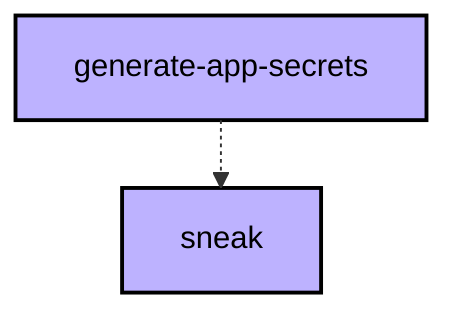

```mermaid
graph TB
  application[application]:::android-application
  composelibrary[composelibrary]:::compose-library
  daggerlibrary[daggerlibrary]:::android-dagger
  androidkotlinlibrary[androidkotlinlibrary]:::android-kotlin
  androidjavalibrary[androidjavalibrary]:::android-java
  jvm[jvm]:::jvm-library
  multiplatformcompose[multiplatformcompose]:::multiplatform-compose
  multiplatform[multiplatform]:::multiplatform-library

  application -.-> feature
  library --> jvm

classDef android-application fill:#CAFFBF,stroke:#000,stroke-width:2px,color:#000;
classDef compose-library fill:#FFD6A5,stroke:#000,stroke-width:2px,color:#000;
classDef android-dagger fill:#9BF6FF,stroke:#000,stroke-width:2px,color:#000;
classDef android-kotlin fill:#A0C4FF,stroke:#000,stroke-width:2px,color:#000;
classDef android-java fill:#C4A0FF,stroke:#000,stroke-width:2px,color:#000;
classDef jvm-library fill:#BDB2FF,stroke:#000,stroke-width:2px,color:#000;
classDef multiplatform-compose fill:#5FB2FF,stroke:#000,stroke-width:2px,color:#000;
classDef multiplatform-library fill:#BD5FFF,stroke:#000,stroke-width:2px,color:#000;
classDef unknown fill:#FFADAD,stroke:#000,stroke-width:2px,color:#000;
```

# `:generate-app-secrets`
A simple commandline tool to generate obfuscated constants you can use in your apps.

## How to use
Start by making a duplicate of `rawsecrets.properties.example`:
```shell
cp rawsecrets.properties.example rawsecrets.properties
```
Open up the newly created `rawsecrets.properties` and provide the appropriate values for each field.
For `raw.salt`, simply generate a random UTF-8 string using a password manager or some other tool (64 characters is the recommended length).

Once you have supplied the appropriate values, run the script in this module using this Gradle command (from the root folder of the project):
```shell
./gradlew :tools:generate-app-secrets:run
```
After Gradle is finished executing, find the generated `secrets.properties` file.
It should be in this current folder.
Copy it over to the `:core:sneak` Gradle module so that your apps can use the freshly obfuscated constants.
Run this command from the root folder of the project:
```shell
mv tools/generate-app-secrets/secrets.properties core/sneak/
```

## Module dependency graph

<!--region graph-->


<details><summary>📋 Graph legend</summary>



</details>
<!--endregion-->
